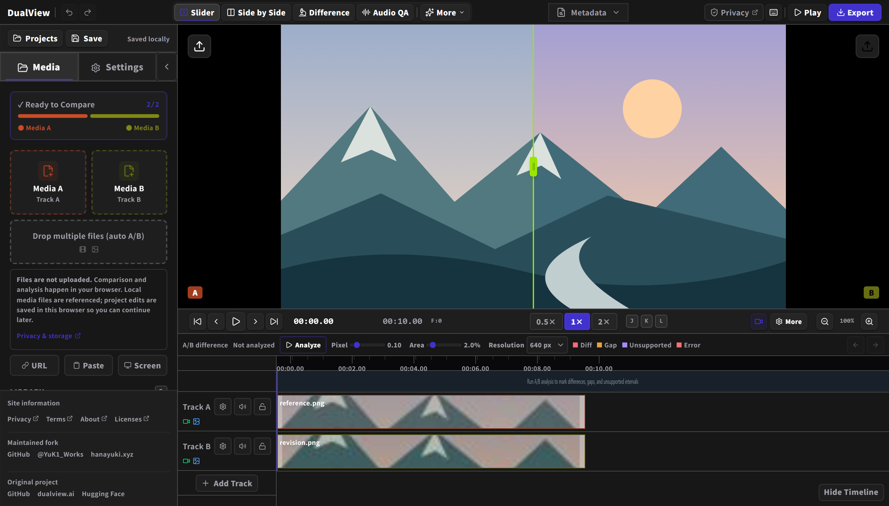
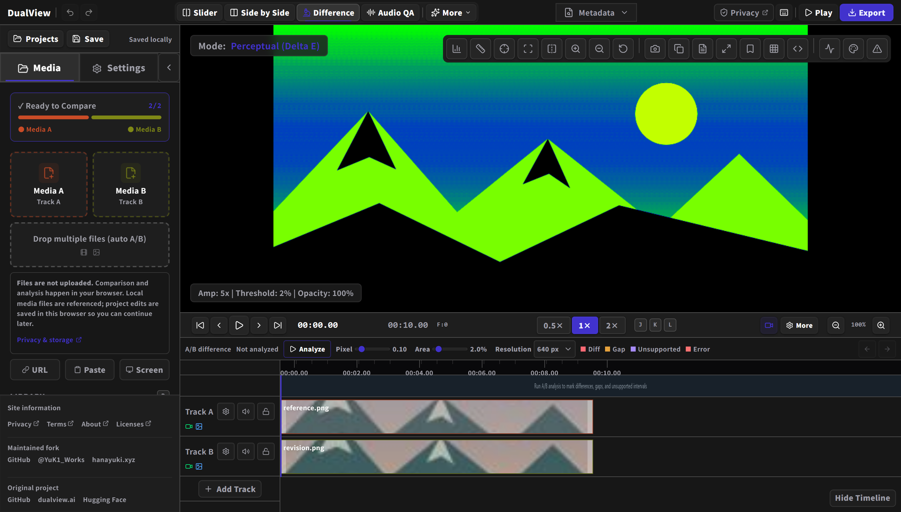

  

<h1 align="center">DualView</h1>

  <strong>Compare images and videos before delivery</strong> 
  Review revisions side by side and find unintended differences in your browser.

  <a href="https://dualview.hanayuki.xyz"><strong>Open the app</strong></a> ·
  <a href="docs/user-guide.en.md">User guide</a> ·
  <a href="README.md">日本語</a>

  

Actual current UI with two original sample images.

<h2 id="features">What you can do</h2>

| Goal                  | Features                                                                          |
| --------------------- | --------------------------------------------------------------------------------- |
| Compare revisions     | Slider wipe, Side by Side, overlays and flicker                                   |
| Align videos          | Synchronized A/B playback, frame steps, clip moves and trims, looping             |
| Find differences      | Current-frame regions, whole-video analysis, color, luminance and edge comparison |
| Check the finish      | ProRes playback, video scopes, pixel inspection and quality metrics               |
| Review embedded audio | Waveforms, loudness estimates, peaks, phase correlation and stereo width          |
| Share findings        | Comparison images, PDF reports, and video/GIF export for supported sources        |

<h2 id="getting-started">Get started</h2>

1. [Open the app](https://dualview.hanayuki.xyz).
2. Drop the images or videos you want to compare, or choose them through `Media A` and `Media B`.
3. Align clip positions and lengths in the timeline when needed.
4. Choose a comparison view, then pause, play or step through frames to inspect the result.
5. Use `Export` to save your findings. Export the project too when backing up or moving your work.

<h2 id="comparison-modes">Choose a view</h2>

- **Slider**: move the divider to compare the same position in A and B.
- **Side by Side**: display both sources together with synchronized video playback.
- **Difference**: emphasize changes in color, brightness and other details.
- **Audio QA**: inspect the audio embedded in the A/B videos.

See the [user guide](docs/user-guide.en.md#comparison-modes) for additional views and settings.

<h3 id="webgl-analysis">Find differences</h3>

  

This example shows two color grades of a still image in `Difference`. Compare the result with the original A/B views as you inspect it.
Use `Analyze` in the timeline to search for differences across a video.
The [analysis and export reference](docs/analysis-reference.md#english) explains how to choose analysis views.

<h2 id="shortcuts">Essential controls</h2>

Click the timeline to activate its shortcuts.

| Action                  | Input                                     |
| ----------------------- | ----------------------------------------- |
| Play / pause            | Tap `Space`                               |
| Move one frame          | `PageUp` / `PageDown`                     |
| Set loop start / end    | `B` / `N`                                 |
| Pan the timeline        | Middle drag / `Space` + left drag         |
| Zoom around the pointer | `Alt` + wheel                             |
| Undo / redo             | `Ctrl/⌘` + `Z` / `Ctrl/⌘` + `Shift` + `Z` |

Clip edits and loop changes support Undo/Redo. Inputs and dialogs retain control of typing.
Key assignments depend on the active panel; see the [shortcut guide](docs/user-guide.en.md#shortcuts).

## Keep your media and work

Local media is processed in your browser and is not uploaded to the operator's server.
Keep the original files available without moving or overwriting them during comparison. Imports show their progress and can be cancelled.

Edits are saved automatically in the current browser and site. Export important work as a `.dualview` project and keep the original media separately.
Work does not move automatically to another browser or site URL. Reconnect unavailable media by selecting the source files again.
See [saving, reconnecting and moving from the old URL](docs/user-guide.en.md#save-and-switch-projects).

<h2 id="export">Supported inputs and exports</h2>

- Inputs are images and videos. Audio review covers audio embedded in videos; standalone audio, text, 3D models and document comparison are not supported.
- ProRes supports playback and current-frame image/PDF output. Animated video/GIF, transition and stitch export are not supported for ProRes.
- Playback, analysis and export capabilities depend on the browser. See the [feature requirements](docs/user-guide.en.md#requirements).
- Quality metrics and audio targets are review aids, not certification of broadcast or platform compliance.

## More information

| Goal                                           | Guide                                                               |
| ---------------------------------------------- | ------------------------------------------------------------------- |
| Learn importing, editing, saving and exporting | [User guide](docs/user-guide.en.md)                                 |
| Choose analysis views and export effects       | [Analysis and export reference](docs/analysis-reference.md#english) |
| Run locally, develop or deploy                 | [Development and deployment](docs/development.md#english)           |

Use [Issues](https://github.com/YukiWorks432/dualview/issues) for bug reports and suggestions, or [Pull requests](https://github.com/YukiWorks432/dualview/pulls) for contributions.
For private material, use the [maintainer's contact page](https://hanayuki.xyz/contact/).

<h2 id="support">Support development</h2>

Support maintenance and continued development of this fork through [GitHub Sponsors](https://github.com/sponsors/YukiWorks432).

<h2 id="project-lineage">Original project and license</h2>

DualView was created by [Gökay Aydoğan](https://github.com/gokayfem) in [gokayfem/dualview](https://github.com/gokayfem/dualview).
This fork is maintained and developed by [花雪 / HanaYuki](https://github.com/YukiWorks432), preserving attribution to the original author.

[MIT License](LICENSE) · [Citation metadata](CITATION.cff) · [Third-party licenses](https://dualview.hanayuki.xyz/licenses/)

[Privacy](https://dualview.hanayuki.xyz/privacy/) ·
[Terms](https://dualview.hanayuki.xyz/terms/) ·
[About](https://dualview.hanayuki.xyz/about/)
