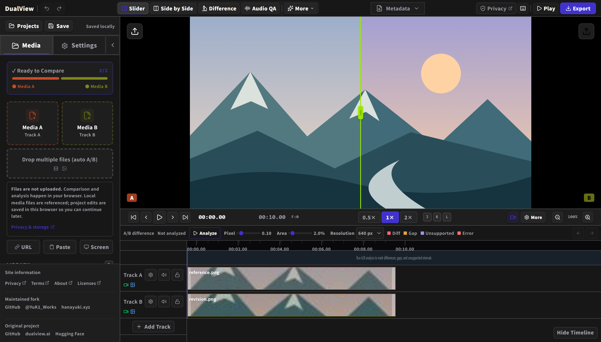
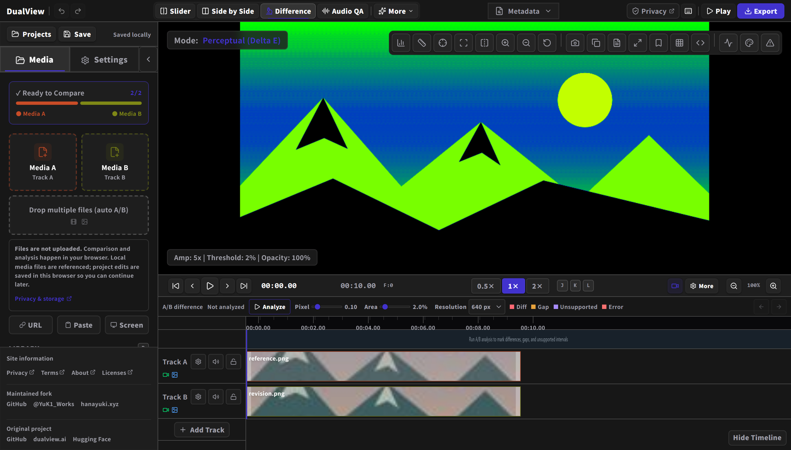

  

<h1 align="center">DualView</h1>

  <strong>画像・動画の納品前レビューを支える比較ツール</strong> 
  修正前後の素材を並べて、変更点や意図しない差分をブラウザーで確認できます。

  <a href="https://dualview.hanayuki.xyz"><strong>アプリを開く</strong></a> ·
  <a href="docs/user-guide.md">利用ガイド</a> ·
  <a href="README.en.md">English</a>

  

独自のサンプル画像2枚を読み込んだ、現在のUIの表示例です。

<h2 id="features">できること</h2>

| やりたいこと         | 主な機能                                                                 |
| -------------------- | ------------------------------------------------------------------------ |
| 修正前後を見比べる   | 境界を動かすSlider表示、Side by Sideの並列表示、重ね合わせや点滅         |
| 動画の位置をそろえる | A/B同期再生、フレーム単位の移動、クリップの移動・トリム、ループ再生      |
| 差分を探す           | 現在のフレームの差分領域表示、動画全体の差分解析、色・明るさ・輪郭の比較 |
| 仕上がりを確かめる   | ProRes再生、動画スコープ、画素の拡大確認、品質指標                       |
| 動画の音声を確認する | 波形、ラウドネスの参考値、ピーク、位相相関、ステレオ幅                   |
| 確認結果を共有する   | 比較画像、PDFレポート、対応する素材からの動画・GIF書き出し               |

<h2 id="getting-started">使い始める</h2>

1. [公開アプリ](https://dualview.hanayuki.xyz)を開きます。
2. 比較する画像・動画をドロップするか、`Media A`と`Media B`から選びます。
3. 必要に応じてタイムラインでクリップの位置や長さをそろえます。
4. 比較表示を選び、停止・再生・フレーム送りで確認します。
5. `Export`から確認結果を書き出します。作業の引き継ぎや保管には、プロジェクトも書き出します。

<h2 id="comparison-modes">比較表示を選ぶ</h2>

- **Slider**：境界を動かして、同じ位置のA/Bを切り替えます。
- **Side by Side**：A/Bを並べ、動画は同期して再生します。
- **Difference**：色や明るさなどの違いを強調します。
- **Audio QA**：A/B動画に含まれる音声を確認します。

ほかの表示や設定は[利用ガイド](docs/user-guide.md#comparison-modes)で紹介しています。

<h3 id="webgl-analysis">差分を見つける</h3>

  

静止画像の色違いを`Difference`で表示した例です。元のA/Bと見比べながら、気になる部分を確認できます。
動画全体の差分を探す場合は、タイムラインの`Analyze`を使います。
解析表示の選び方は[解析・書き出しリファレンス](docs/analysis-reference.md)をご覧ください。

<h2 id="shortcuts">主な操作</h2>

タイムラインをクリックすると、そのパネルがキー操作を受け持ちます。

| 操作                               | キー・マウス                           |
| ---------------------------------- | -------------------------------------- |
| 再生・停止                         | `Space`の短押し                        |
| 1フレーム移動                      | `PageUp` / `PageDown`                  |
| ループ範囲の開始・終了             | `B` / `N`                              |
| 表示範囲の移動                     | 中ドラッグ / `Space`＋左ドラッグ       |
| ポインターの位置を基準に拡大・縮小 | `Alt`＋ホイール                        |
| 元に戻す・やり直す                 | `Ctrl/⌘`＋`Z` / `Ctrl/⌘`＋`Shift`＋`Z` |

クリップ編集やループ範囲の変更を元に戻せます。入力欄やダイアログ内では、その画面の操作を優先します。
操作場所によってキーの役割が変わるため、詳しくは[ショートカット一覧](docs/user-guide.md#shortcuts)をご覧ください。

## 素材と作業を保存する

読み込んだローカル素材は、運営者のサーバーへアップロードされません。
元ファイルを参照して使うため、比較中は元の素材を移動・上書きせず保持してください。取り込みは進捗を確認しながら中止できます。

編集内容は利用中のブラウザーとサイトに自動保存されます。重要な作業は`.dualview`プロジェクトとして書き出し、元の素材も別途保管してください。
別のブラウザーやサイトへ自動では引き継がれません。素材が見つからない場合は再指定して接続できます。
[保存・再接続と旧URLからの移行方法](docs/user-guide.md#プロジェクトを保存切り替えする)をご確認ください。

<h2 id="export">対応範囲と書き出し</h2>

- 入力は画像・動画です。音声の確認は動画に含まれる音声を対象とし、単独の音声、テキスト、3Dモデル、文書ファイルの比較には対応していません。
- ProResは再生と現在のフレームの画像・PDF出力に対応しています。動画・GIF・トランジション・連結の書き出しには対応していません。
- 再生・解析・書き出しの対応範囲はブラウザーによって異なります。[機能別の動作条件](docs/user-guide.md#requirements)をご覧ください。
- 品質指標や音声の参照値は確認の目安です。放送・配信規格への適合を認証するものではありません。

## 詳しい資料

| 目的                                       | 資料                                                     |
| ------------------------------------------ | -------------------------------------------------------- |
| 素材の取り込み、編集、保存、書き出しを知る | [利用ガイド](docs/user-guide.md)                         |
| 解析表示や切り替え効果を使い分ける         | [解析・書き出しリファレンス](docs/analysis-reference.md) |
| 自分の環境で動かす、開発する、公開する     | [開発・公開手順](docs/development.md)                    |

不具合・改善提案は[Issues](https://github.com/YukiWorks432/dualview/issues)、変更提案は[Pull requests](https://github.com/YukiWorks432/dualview/pulls)へお寄せください。
非公開の素材を含む問い合わせは[保守者の窓口](https://hanayuki.xyz/contact/)をご利用ください。

<h2 id="support">継続開発の支援</h2>

このフォークの保守・継続開発は[GitHub Sponsors](https://github.com/sponsors/YukiWorks432)から支援できます。

<h2 id="project-lineage">原プロジェクトとライセンス</h2>

DualViewの原作者は[Gökay Aydoğan](https://github.com/gokayfem)、原プロジェクトは[gokayfem/dualview](https://github.com/gokayfem/dualview)です。
このフォークは[花雪 / HanaYuki](https://github.com/YukiWorks432)が、原作者への帰属を保ちながら保守・継続開発しています。

[MIT License](LICENSE) · [引用情報](CITATION.cff) · [第三者ライセンス](https://dualview.hanayuki.xyz/licenses/)

[プライバシー](https://dualview.hanayuki.xyz/privacy/) ·
[利用条件](https://dualview.hanayuki.xyz/terms/) ·
[サイトについて](https://dualview.hanayuki.xyz/about/)
